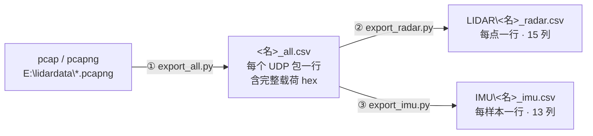
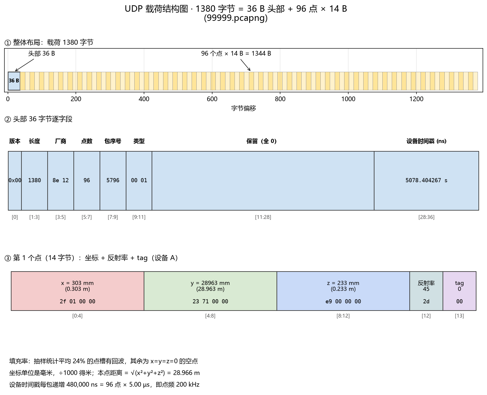
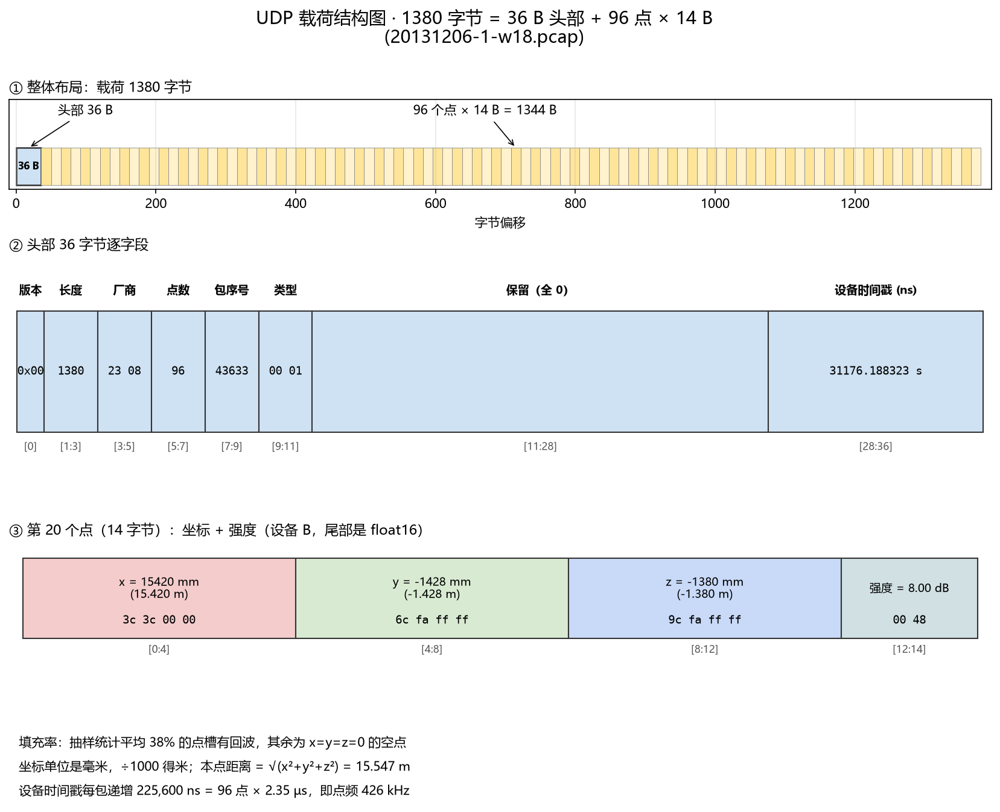
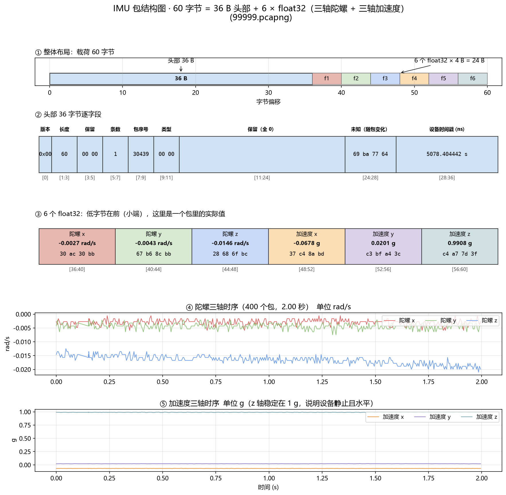
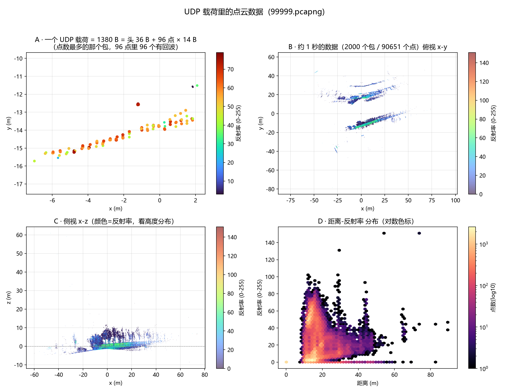
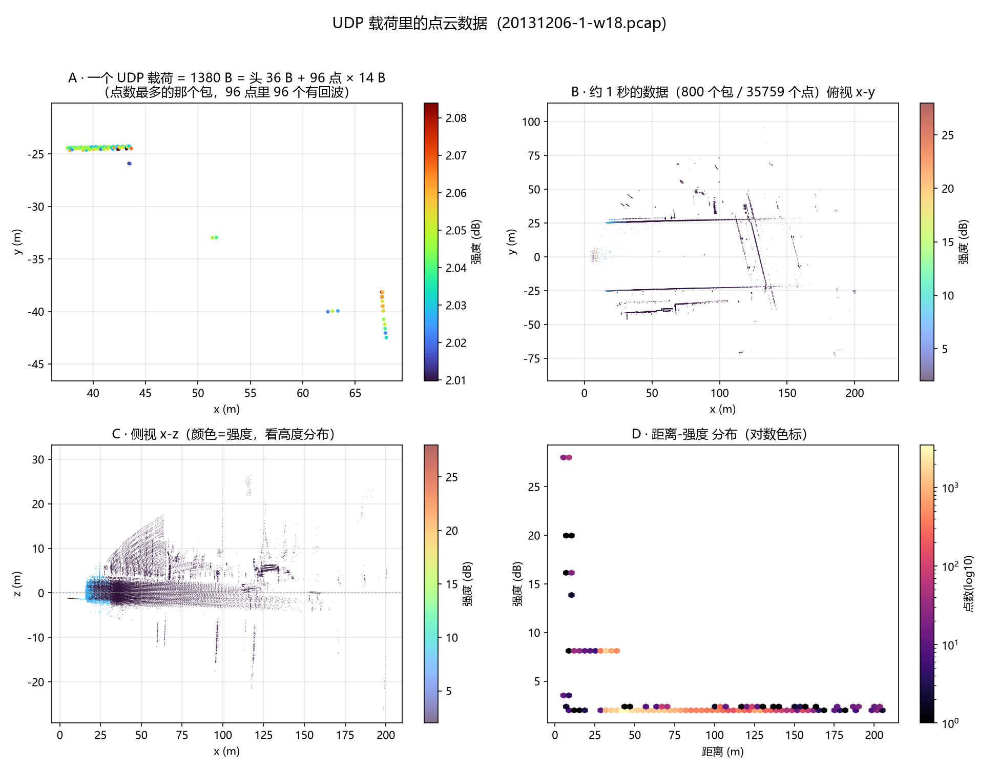

# pcap → CSV：流程、数据流与载荷结构

本文整理这个项目从抓包到可用数据集的完整链路：**每一步吃什么、吐什么、字段怎么对应、图怎么来的**。

- 代码目录：`E:\pycharm project\pacp——csv\`
- 产物目录：`LIDAR\`（雷达）、`IMU\`、`E:\dsh-output\`（中间文件）
- 原始抓包：`E:\lidardata\`

---

## 1. 总览



纯文本版（不支持 mermaid 的编辑器看这个）：

```
pcap/pcapng
   │  ① export_all.py     ← 唯一解析 pcap 的地方
   ▼
<名>_all.csv   (No, Time, EpochTime, 五元组, UDPLen, PayloadHex)
   ├── ② export_radar.py  ──►  LIDAR\<名>_radar.csv   (15 列，逐点)
   └── ③ export_imu.py    ──►  IMU\<名>_imu.csv       (13 列，逐样本)
```

**为什么这样拆**：pcap 只解析一次；②③ 都只是“读 CSV + 按列过滤解码”，改格式、加字段、重跑都不用再碰 2 GB 的原始抓包。

---

## 2. 三步流程

### 第 1 步 · `export_all.py` —— 全量导出

| 项 | 内容 |
|---|---|
| 输入 | `.pcap` / `.pcapng`（默认 `E:\lidardata\99999.pcapng`，见脚本第 32 行 `DEFAULT_PCAP`） |
| 输出 | `E:\pycharm project\pacp——csv\all\<抓包名>_all.csv`（`ALL_DIR` 常量控制） |
| 列 | `No, Time, EpochTime, SrcIP, SrcPort, DstIP, DstPort, UDPLen, PayloadHex` |
| 默认行为 | 载荷**完整**写入（`--hex 0`），下游解码需要 |
| 常用参数 | `--hex 32` 只要前 32 字节（文件小很多）、`--start` / `--duration` 截时间段、`--max-packets` |

```bat
python export_all.py "E:\lidardata\99999.pcapng"
python export_all.py "E:\lidardata\99999.pcapng" --duration 10
```

实测（99999 前 6 秒）：**13,701 个 UDP 包 → 34.2 MB**，三条流：

```
192.168.1.100:56300 -> 192.168.1.181:56301   12494 包   ← 点云
192.168.1.100:56400 -> 192.168.1.181:56401    1201 包   ← IMU
192.168.1.100:56200 -> 255.255.255.255:56201     6 包   ← 广播
```

### 第 2 步 · `export_radar.py` —— 雷达点云

| 项 | 内容 |
|---|---|
| 输入 | ① 的 `*_all.csv`（`-i` 指定；缺省取最新的） |
| 输出 | `LIDAR\<名>_radar.csv` |
| 识别方式 | **不写死端口**：载荷 1380 B + 前缀 `00 64 05` + 点数域 = 96 |
| 点尾判断 | 端口 57000 → float16 强度；其它 → u8 反射率 + u8 tag |
| 常用参数 | `--keep-zero` 保留空点、`--split N` 切片、`--max-points N` 试跑 |

```bat
python export_radar.py
python export_radar.py -i "all\w18_all.csv" -o "LIDAR\w18_radar.csv"
```

实测：**12,494 个点云包 → 318,994 个点，25.0 MB**（空点已丢弃）。

### 第 3 步 · `export_imu.py` —— IMU

| 项 | 内容 |
|---|---|
| 输入 | ① 的 `*_all.csv` |
| 输出 | `IMU\<名>_imu.csv`（列格式对齐 `WaterScenes_Samples/imu/*.csv`） |
| 识别方式 | 载荷 60 B 且 `[1:3]` 长度域 = 60 |
| 常用参数 | `--gyro-deg` 角速度转 deg/s、`--flat-attitude` 不反解姿态、`--max-rows` |

```bat
python export_imu.py
```

实测：**1,201 条，200 Hz，6 秒**。若抓包里没有 IMU 流（比如 w18），会明确提示“见到的载荷长度分布”，而不是默默出一条空文件。

---

## 3. 数据流：字节怎么变成列

### 3.1 点云：1380 B → 96 点 → 15 列

```
UDP 载荷 1380 B
├── [0:36]    头部 36 B ─────────────► timestamp（取自 [28:36] 或抓包时间）
└── [36:1380] 96 × 14 B
     每 14 B：
     ├─ [0:4]   int32 x (mm) ────────► x（÷1000 → m）
     ├─ [4:8]   int32 y (mm) ────────► y
     ├─ [8:12]  int32 z (mm) ────────► z
     └─ [12:14] 尾巴 2 B ────────────► power
                 · 设备 A：u8 反射率 + u8 tag
                 · 设备 B：float16 强度(dB)
```

派生列：`range = √(x²+y²+z²)`、`azimuth = atan2(y,x)`、`elevation = atan2(z,√(x²+y²))`；
`doppler` / `comp_height` / `comp_velocity` / `u,v` 留空（雷达/相机专有量），`label=-1`、`instance=0`。

### 3.2 IMU：60 B → 6 个 float32 → 13 列

```
UDP 载荷 60 B
├── [0:36]  头部 36 B ───────────────► timestamp
└── [36:60] 6 × float32（小端）
     ├─ [36:40] 角速度 x (rad/s) ────► angular_velocity_x
     ├─ [40:44] 角速度 y ────────────► angular_velocity_y
     ├─ [44:48] 角速度 z ────────────► angular_velocity_z
     ├─ [48:52] 加速度 x (g) ────────► linear_acceleration_x（× 9.80665 → m/s²）
     ├─ [52:56] 加速度 y ────────────► linear_acceleration_y
     └─ [56:60] 加速度 z ────────────► linear_acceleration_z
```

姿态列由重力方向反解：`pitch = atan2(-ax, √(ay²+az²))`、`roll = atan2(ay, az)`；
`yaw` 与 `magnetic_field_x/y/z` 留空（设备无磁力计）。

---

## 4. UDP 载荷结构图

### 4.1 设备 A（端口 56300，`99999` / `6666` / `7777` / `8888888` / `yyy`）



- 点尾 2 字节 = `u8 反射率 + u8 tag`
- 设备时间戳每包 +480,000 ns = 96 点 × **5.00 µs** → 点频 **200 kHz**
- 抽样填充率约 **24%**（其余点是 x=y=z=0 的空点）

### 4.2 设备 B（端口 57000，`20131206-1-w18`）



与 A 的差异只有三处：

| 项 | 设备 A | 设备 B |
|---|---|---|
| 端口 | 56300 → 56301 | 57000 → 57000 |
| 点尾 2 B | u8 反射率 + u8 tag | **float16 强度（dB）** |
| 点间隔 | 固定 5.00 µs | 动态 **2.35 µs**（包间隔 225,600 ns） |
| 点频 | 200 kHz | **426 kHz** |
| 填充率 | 24% | 38% |

### 4.3 IMU 包（端口 56400，60 字节）



- 头部 `[5:7]` 是“条数”= 1（每包一组 IMU），`[9:11]` 类型 `00 00`（点云是 `00 01`）
- 静止时加速度 z ≈ **0.99 g**，陀螺三轴都在 ±0.02 rad/s 内

### 4.4 点云可视化（同一批数据画出来）

| 设备 A | 设备 B |
|---|---|
|  |  |

生成脚本：`E:\dsh-output\plot_payload.py`（设备 A）/ 同脚本 `--sport 57000`（设备 B）。

---

## 5. 产物清单

| 文件 | 位置 | 说明 |
|---|---|---|
| `*_all.csv` | `all\` | 中间文件，每包一行，体积最大 |
| `*_radar.csv` | `LIDAR\` | 雷达点云，WaterScenes radar 15 列 |
| `*_imu.csv` | `IMU\` | IMU，WaterScenes imu 13 列 |
| `*.png` | `photo\` | 本文引用的结构图与点云图 |

代码文件：

| 文件 | 职责 | 输入 → 输出 |
|---|---|---|
| `udp_common.py` | pcap/pcapng 解析 + UDP 提取（公共层，口径唯一） | 无 → 无（被 import） |
| `export_all.py` | ① 全量导出 | pcap → `all\*_all.csv` |
| `export_radar.py` | ② 雷达导出（读 ①） | `all\*_all.csv` → `LIDAR\*_radar.csv` |
| `export_imu.py` | ③ IMU 导出（读 ①） | `all\*_all.csv` → `IMU\*_imu.csv` |
| `tools\draw_payload_map.py` | 画点云包结构图 | pcap → `photo\A-file.png` / `B-file.png` |
| `tools\draw_imu_map.py` | 画 IMU 包结构图与时序 | pcap → `photo\imu.png` |
| `tools\plot_payload.py` | 画点云俯视/侧视分布 | pcap → `photo\points-A.png` / `points-B.png` |

---

## 6. 校验清单

跑完一轮后，用这几条快速判断结果对不对：

1. **包数对得上**：`_all.csv` 行数 − 1 = ① 打印的“N 个 UDP 包”
2. **点的量级**：点云包数 × 96 × 填充率 ≈ `_radar.csv` 行数（A 约 24%，B 约 38%）
3. **IMU 频率**：`(行数-1) / 时长 ≈ 200 Hz`（设备 A）
4. **加速度单位**：`linear_acceleration_z ≈ 9.7~9.8`（m/s²）；若解出 0.99，说明没乘 9.80665
5. **IMU 字节序探针**：`c4 a7 7d 3f` 按小端 float32 应是 **0.9908**，解成别的就是偏移或端序错了
6. **Excel 打开前**：单表上限 1,048,576 行，超过用 `--split`

---

## 7. 常见坑

| 现象 | 原因 | 处理 |
|---|---|---|
| `_radar.csv` 只有表头 | 端口/载荷特征不匹配 | 先看 ① 打印的流列表，再核对 `is_point_packet()` |
| `_all.csv` 巨大（数 GB） | 默认写完整载荷 | `--hex 32` 或 `--duration` 截段 |
| ②③ 读错了数据 | `default_all_csv()` 取**最新**的 `_all.csv` | 多份数据时显式 `-i` |
| 时间戳重复 | 老抓包精度粗（w18 约 3.6 包共用同一时间戳） | 用设备时间戳 `[28:36]` 计算点内时间 |
| 图上中文变方块 | 缺中文字体 | 脚本已按 Microsoft YaHei 兜底 |

---

## 8. 总结

### 8.1 做成了什么

一套**只用标准库**的抓包解析工具：从原始 pcap 一路产到可直接喂算法的 CSV，中间只解析一次 pcap。

| 能力 | 产物 | 规模（99999 前 6 秒样本） |
|---|---|---|
| 全量 UDP 导出 | `all\*_all.csv` | 13,701 包 / 34.2 MB |
| 雷达点云 | `LIDAR\*_radar.csv` | 318,994 点 / 25.0 MB |
| IMU | `IMU\*_imu.csv` | 1,201 条 / 200 Hz |

已有 6 份 `_all.csv` 入库前的中间文件，合计 **6.21 GB**（`yyy` 3.5 GB、`8888888` 1.26 GB、`6666` 836 MB、`7777` 522 MB、`w18` 51 MB、`99999` 34 MB）。

### 8.2 逆向出来的协议结论

| 项 | 结论 |
|---|---|
| 点云包 | 1380 B = 36 B 头 + 96 点 × 14 B；头含长度/点数/包序号/纳秒时间戳 |
| 点结构 | int32 x,y,z（毫米）+ 2 B 尾巴 |
| 设备 A（56300） | 尾巴 = u8 反射率 + u8 tag；5 µs/点 → 200 kHz；填充率 24% |
| 设备 B（57000） | 尾巴 = float16 强度(dB)；2.35 µs/点 → 426 kHz；填充率 38% |
| IMU（56400） | 60 B = 36 B 头 + 6 × float32（陀螺 rad/s + 加速度 g），200 Hz |
| 广播（56200） | `aa 00` 开头 + TLV：IP/掩码/网关、广播地址与端口 56201 |

### 8.3 工程上做了什么

- **公共层收敛**：pcap/pcapng 解析、UDP 提取、`all.csv` 逐行读取都收在 `udp_common.py`，三个脚本共用一份口径
- **去重**：②③ 原来各自写了一遍“读 CSV + 建列索引 + 逐行过滤”，改成共用一个 `iter_all_rows()` 生成器
- **清死代码**：删掉画图脚本里未被调用的 `_legacy_grab()`；三个脚本经 AST 检查**无未使用导入**
- **修 bug**：`export_radar.py` 原先不会创建输出目录（`export_imu.py` 会），指定不存在的目录会直接报错，已补齐
- **目录规范化**：`all\`（①）、`LIDAR\`（②）、`IMU\`（③）、`photo\`（图），路径常量集中在文件头

### 8.4 已知限制

1. **IMU 没有磁力计**：`yaw` 与 `magnetic_field_*` 只能留空，`pitch/roll` 由重力反解，只在静止/缓变时可靠
2. **坐标是传感器系**：`x,y,z` 没有姿态补偿，若要和 WaterScenes 的世界坐标系对齐，需要 IMU 姿态 + 外参
3. **雷达专有列留空**：`doppler`、`comp_height`、`comp_velocity`、`u,v` 本设备采不到
4. **`_all.csv` 体积**：默认存完整载荷，w18 全量约 4 GB；只为看结构时用 `--hex 32`
5. **Excel 行数上限**：104 万行，超过用 `--split`

### 8.5 下一步可以做的

- 用 IMU 姿态把点云转到水平/世界坐标，再与 WaterScenes 的雷达标定体系对齐
- 按时间窗做特征（点密度、距离分布、反射率衰减），用于水面目标检测
- 把 `_all.csv` 换成 parquet，体积可降一个数量级，pandas 读取也更快

